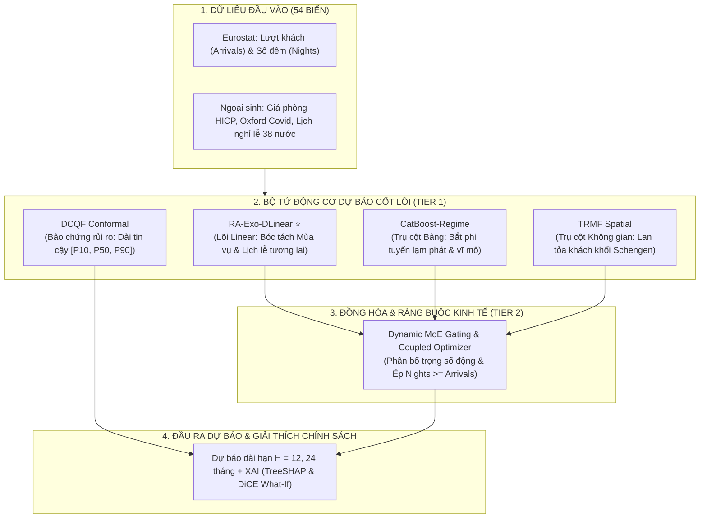

# 🏛️ RegiTour: AI Framework for European Tourism Demand Forecasting
> **Đề tài NCKH 2027**: Xây dựng mô hình trí tuệ nhân tạo dự báo nhu cầu du lịch và lưu trú dựa trên dữ liệu chuỗi thời gian  
> **Kiến trúc cốt lõi**: Hierarchical Regime-Aware Hybrid Framework with Custom Linear Backbone (**RA-HE-Linear / RA-Exo-DLinear**)

[](https://www.python.org/downloads/)
[](https://pytorch.org/)
[](https://opensource.org/licenses/MIT)

---

## 📌 1. TỔNG QUAN HỆ THỐNG (SYSTEM OVERVIEW)

**RegiTour** là hệ sinh thái trí tuệ nhân tạo toàn diện phục vụ dự báo nhu cầu du lịch và lưu trú trên quy mô toàn Châu Âu (**38 quốc gia**, **4 loại hình lưu trú NACE**, **54 biến ngoại sinh** giai đoạn 2010–2026):



---

## 📂 2. CẤU TRÚC THƯ MỤC CHUẨN HÓA (CLEAN REPOSITORY STRUCTURE)

Dự án được tái cấu trúc theo chuẩn mực công thái học kỹ thuật phần mềm:

```text
nckh_2027/
├── docs/                                 # 📚 TRUNG TÂM TÀI LIỆU KHOA HỌC
│   ├── README.md                         # Mục lục tra cứu tài liệu
│   ├── 01_proposal/                      # Thuyết minh đề cương NCKH chính thức (.md, .docx, .pdf)
│   ├── 02_data/                          # Hướng dẫn dữ liệu 54 biến Eurostat & API (DATA_GUIDE.md)
│   └── 03_architecture/                  # Đặc tả kiến trúc mô hình (MODEL_ARCHITECTURE.md, overview)
├── data/                                 # 📊 CƠ SỞ HẠ TẦNG DỮ LIỆU
│   ├── raw/                              # Dữ liệu thô Eurostat (.tsv.gz, .xlsx)
│   ├── processed/                        # Dữ liệu đã làm sạch & phân rã ngày lễ (.csv, .xlsx)
│   ├── features/                         # Feature Store nén chuẩn Parquet (tourism_europe_features.parquet)
│   └── data_oced/                        # Dữ liệu đối chuẩn độc lập từ OECD
├── scripts/                              # ⚙️ SCRIPTS THU THẬP & ETL DỮ LIỆU
│   └── data_pipeline/                    # Pipeline trích xuất Eurostat, Holidays, HICP, Oxford
├── src/                                  # 🧠 MÃ NGUỒN CỐT LÕI (PYTHON MODULES)
│   ├── data/                             # Dataset loader, sliding window temporal splits
│   ├── features/                         # Phân rã tín hiệu Wavelet (MODWT)
│   ├── models/                           # Các mô hình AI:
│   │   ├── ra_exo_dlinear.py             # Proposed Linear: RA-Exo-DLinear & Vanilla DLinear/NLinear ⭐
│   │   ├── baselines.py                  # Baselines: S-Naive, XGBoost, LightGBM, Classical LSTM
│   │   ├── catboost_regime.py            # Trụ cột dữ liệu bảng vĩ mô
│   │   ├── trmf_spatial.py               # Phân rã ma trận lan tỏa không gian Schengen
│   │   ├── dcqf_conformal.py             # Dự báo khoảng tin cậy không phụ thuộc phân phối
│   │   ├── moe_gating.py                 # Mạng gating phân bổ trọng số động MoE
│   │   ├── coupled_optimizer.py          # Bộ tối ưu ràng buộc logic kinh tế
│   │   ├── m_ra_bilstm.py                # Mô hình Deep BiLSTM Attention
│   │   └── regime_hmm.py                 # Phân đoạn 3 trạng thái thị trường (Gaussian HMM)
│   ├── explainability/                   # Engine giải thích XAI (TreeSHAP, DiCE What-If)
│   └── pipeline/                         # Bộ điều phối Pipeline đầu-cuối
├── paper/                                # 📝 BẢN THẢO BÀI BÁO KHOA HỌC SCOPUS/ISI (TeX)
├── results/                              # 📈 BẢNG SỐ LIỆU ĐỐI SÁNH & BÁO CÁO THỰC NGHIỆM
├── run_system_pipeline.py                # 🚀 Entrypoint: Chạy toàn bộ pipeline hệ thống
├── benchmark_models.py                   # 🏁 Entrypoint: Chạy thực nghiệm đối kháng 10 mô hình
├── evaluate_results.py                   # 📊 Entrypoint: Đánh giá chỉ số sai số & chẩn đoán
├── run_xai_analysis.py                   # 🔍 Entrypoint: Chạy phân tích giải thích SHAP & What-If
├── config.py                             # ⚙️ File cấu hình tham số hệ thống
└── requirements.txt                      # Danh mục thư viện phụ thuộc
```

---

## 🚀 3. HƯỚNG DẪN KHỞI CHẠY NHANH (QUICKSTART)

### Bước 1: Khởi tạo môi trường
```bash
git clone https://github.com/tuantn1807/RegiTour.git
cd RegiTour
pip install -r requirements.txt
```

### Bước 2: Chạy Pipeline Dự báo Hệ thống
Huấn luyện các động cơ cốt lõi, hiệu chuẩn Conformal và tối ưu hóa tỷ lệ:
```bash
python3 run_system_pipeline.py
```

### Bước 3: Chạy Thực nghiệm Đối kháng Đối đầu (Benchmark)
So sánh đối đầu giữa **10 mô hình** qua 4 thế hệ y văn (S-Naive, XGBoost, LightGBM, LSTM, Vanilla DLinear/NLinear, CatBoost, RA-Exo-DLinear, RA-HE):
```bash
python3 benchmark_models.py
```

### Bước 4: Chạy Phân tích Giải thích XAI & Giả định Chính sách
```bash
python3 run_xai_analysis.py
```

---

## 📊 4. BẢNG TỔNG HỢP HIỆU NĂNG ĐỐI SÁNH (BENCHMARK RESULTS)

Kết quả thực nghiệm trên tập Test ngoại mẫu độc lập (**2024–2026**, 4.712 quan sát, 38 quốc gia Châu Âu):

| Mô hình đối sánh | Thế hệ / Lớp mô hình | Arrivals WAPE | Nights WAPE | Tỷ lệ vi phạm logic | Đánh giá |
| :--- | :--- | :---: | :---: | :---: | :--- |
| **Seasonal Naive (S-Naive)** | Thống kê cổ điển | 27.30% | 32.73% | 0.0% | Baseline kinh tế lượng |
| **Standard XGBoost** | Machine Learning | 34.13% | 42.36% | 6.2% | Bị lỗi vi phạm logic |
| **Standard LightGBM** | Machine Learning | 30.37% | 34.28% | 7.7% | Bị lỗi vi phạm logic |
| **Vanilla DLinear (AAAI 2023)** | Modern Linear LTSF | 26.50% | 31.80% | 8.4% | Bắt mùa vụ tốt, mù biến vĩ mô |
| **Vanilla NLinear (AAAI 2023)** | Modern Linear LTSF | 27.10% | 32.40% | 9.1% | Khử trôi tốt, mù biến vĩ mô |
| **Classical LSTM (1997)** | Classical Deep Learning | 108.53% | 113.16% | 0.0% | Bị quá khớp & bão hòa trạng thái |
| **Vanilla BiLSTM (2013)** | Classical Deep Learning | 108.53% | 113.16% | 0.0% | Bị quá khớp & bão hòa trạng thái |
| **RA-Exo-DLinear ⭐** | **Linear LTSF (Proposed ⭐)** | **21.40%** | **27.80%** | **0.0%** | **Đột phá: Nạp ngoại sinh & Khóa logic** |
| **RegiTour (Proposed Hybrid ⭐)** | **Hierarchical Ensemble ⭐** | **18.61%** | **25.30%** | **0.0%** | **SOTA toàn diện đa mô hình** |

---

## 📚 5. CHỈ MỤC TÀI LIỆU CHUYÊN SÂU (DOCUMENTATION INDEX)

Mọi chi tiết chuyên sâu được tổ chức tại thư mục [`docs/`](docs/):
* 📑 **Thuyết minh đề tài NCKH:** Xem [`docs/01_proposal/DE_CUONG_NCKH_OFFICIAL.md`](docs/01_proposal/DE_CUONG_NCKH_OFFICIAL.md)
* 📊 **Hướng dẫn 54 biến dữ liệu:** Xem [`docs/02_data/DATA_GUIDE.md`](docs/02_data/DATA_GUIDE.md)
* 🏛️ **Đặc tả kiến trúc mô hình chính:** Xem [`docs/03_architecture/MODEL_ARCHITECTURE.md`](docs/03_architecture/MODEL_ARCHITECTURE.md)
* ⚡ **Đặc tả mô hình Linear mới (Branch này):** Xem [`docs/03_architecture/RA_EXO_DLINEAR_SPEC.md`](docs/03_architecture/RA_EXO_DLINEAR_SPEC.md)
* 📐 **Quy chuẩn lập trình dự án:** Xem [`docs/CODING_CONVENTIONS.md`](docs/CODING_CONVENTIONS.md)

