# 📚 HƯỚNG DẪN DỮ LIỆU ĐẦU VÀO VÀ CƠ SỞ HẠ TẦNG DỮ LIỆU (DATA GUIDE & INFRASTRUCTURE)
## Đề tài: Xây dựng mô hình trí tuệ nhân tạo dự báo nhu cầu du lịch và lưu trú dựa trên dữ liệu chuỗi thời gian

---

## 1. TỔNG QUAN KIẾN TRÚC DỮ LIỆU (DATA ARCHITECTURE & INFRASTRUCTURE)

Để phục vụ các mô hình Học sâu chuỗi thời gian SOTA (**Temporal Fusion Transformer - TFT**, **PatchTST**) và **Trí tuệ nhân tạo giải thích được tạo kịch bản hành động (DiCE Counterfactual XAI)**, hệ thống dữ liệu được xây dựng theo kiến trúc luồng dữ liệu 3 tầng (**Medallion Data Architecture**):

```mermaid
flowchart TD
    subgraph Data_Sources ["1. CÁC NGUỒN DỮ LIỆU ĐẦU VÀO"]
        S1["Eurostat SDMX 2.1 API<br/>(Lưu trú, Khách, Công suất)"]
        S2["Eurostat HICP API<br/>(Chỉ số giá Khách sạn & Nhà hàng)"]
        S3["Oxford OxCGRT Tracker<br/>(Chỉ số can thiệp/phong tỏa COVID-19)"]
        S4["Open-Meteo / ERA5 API<br/>(Nhiệt độ, Sóng nhiệt, Lượng mưa)"]
        S5["Google Trends (PyTrends)<br/>(Chỉ số tìm kiếm du lịch trước 1-2 tháng)"]
        S6["Calendar & Holidays Engine<br/>(Lễ hội, Ngày lễ quốc gia, Cuối tuần)"]
    end

    subgraph Bronze_Layer ["2. BRONZE LAYER (Raw Ingestion)"]
        B1["Tải & giải nén gzip TSV/CSV"]
        B2["Caching dữ liệu thô tại data/raw/"]
    end

    subgraph Silver_Layer ["3. SILVER LAYER (Harmonization & Cleaning)"]
        SV1["Chuẩn hóa khóa liên kết: (date, geo, accommodation_type)"]
        SV2["Xử lý Missing Data (Spline Interpolation & Forward Fill)"]
        SV3["Phát hiện & Xử lý Outlier / Flag Eurostat (: , c, p, e, u)"]
    end

    subgraph Gold_Layer ["4. GOLD LAYER (Feature Store & Model Input)"]
        G1["Feature Engineering (Lags, Rolling, Sin/Cos)"]
        G2["Regime Segmentation (HMM / Tri-State Labels)"]
        G3["Exogenous Fusion (Macro + Weather + Search + Policy)"]
        G4["Xuất định dạng chuẩn Parquet / CSV / Database"]
    end

    subgraph Downstream ["5. downstream ai & xai applications"]
        D1["CatBoost-Regime (Tabular)"]
        D2["PatchTST-Regime (Deep Patch)"]
        D3["TFT-Regime (Multi-Horizon Transformer)"]
        D4["DiCE What-If Counterfactual Policy Simulator"]
    end

    Data_Sources --> Bronze_Layer
    Bronze_Layer --> Silver_Layer
    Silver_Layer --> Gold_Layer
    Gold_Layer --> Downstream
```



### 1.1. Hạ tầng công nghệ & Thư viện sử dụng
* **Môi trường & Ngôn ngữ:** Python 3.10+
* **Truy xuất dữ liệu (Data Ingestion):** `requests`, `urllib3`, `gzip`, `openmeteo-requests`, `pytrends`.
* **Xử lý ma trận dữ liệu bảng (Data Wrangling):** `pandas` (>= 2.0), `polars` (tối ưu xử lý file lớn), `numpy`, `scipy` (Spline Interpolation).
* **Quản lý lịch biểu & sự kiện:** `holidays` (hỗ trợ lịch lễ toàn bộ 38 quốc gia Châu Âu), `workalendar`.
* **Định dạng lưu trữ:**
  * **Apache Parquet (`.parquet`):** Chuẩn nén cột (Snappy/ZSTD), giảm 80% dung lượng, tốc độ đọc nhanh gấp 10 lần CSV, giữ nguyên kiểu dữ liệu (Schema-preserved).
  * **CSV (`.csv`) & Excel (`.xlsx`):** Dùng cho báo cáo, chia sẻ và tích hợp Web Dashboard (Streamlit/Gradio).
* **Kiểm định chất lượng dữ liệu (Data Quality Gates):**
  * Tỷ lệ thiếu dữ liệu tối đa cho phép: `< 5%` (áp dụng nội suy Spline). Các trường hợp khuyết toàn chuỗi dài hạn (ví dụ Moldova - MD) bị loại trừ khỏi tập huấn luyện.
  * Giới hạn logic: $0 \le \text{hotel\_occupancy\_pct} \le 100\%$; $\text{nights\_total} \ge \text{arrivals\_total}$.

---

## 2. BẢNG TỔNG HỢP CÁC NGUỒN DỮ LIỆU (LINKS & API ENDPOINTS)

Dưới đây là danh mục toàn bộ các nguồn dữ liệu chính và bổ sung, kèm theo đường dẫn chính thức và mã chỉ số kỹ thuật:

| STT | Nhóm dữ liệu | Tên bộ dữ liệu & Chỉ số | Đơn vị chủ quản / Nguồn | Đường dẫn chính thức (URL / API Endpoint) | Định dạng & Truy xuất |
| :---: | :--- | :--- | :--- | :--- | :--- |
| **1** | **Dữ liệu Cốt lõi Lưu trú (Core Target)** | • `tour_occ_nim`: Số lượt khách đến & Đêm lưu trú hàng tháng<br>• `tour_occ_mnor`: Công suất sử dụng phòng & giường khách sạn hàng tháng<br>• `tour_occ_arm`: Dữ liệu lưu trú hàng năm (bổ trợ) | **Eurostat** (Ủy ban Châu Âu) | • [Eurostat Tourism Portal](https://ec.europa.eu/eurostat/web/tourism/database)<br>• API TSV Gzip: `https://ec.europa.eu/eurostat/api/dissemination/sdmx/2.1/data/tour_occ_nim?format=TSV&compressed=true`<br>• API Công suất: `https://ec.europa.eu/eurostat/api/dissemination/sdmx/2.1/data/tour_occ_mnor?format=TSV&compressed=true` | SDMX 2.1 REST API (TSV.gz / JSON) |
| **2** | **Giá cả & Lạm phát (Price & Inflation)** | • `prc_hicp_midx`: Chỉ số giá tiêu dùng hài hòa (HICP)<br>• Phân nhóm `CP112`: Dịch vụ lưu trú (Accommodation services)<br>• Phân nhóm `CP073`: Dịch vụ vận tải hành khách | **Eurostat** | • [Eurostat HICP Database](https://ec.europa.eu/eurostat/web/hicp/database)<br>• API HICP: `https://ec.europa.eu/eurostat/api/dissemination/sdmx/2.1/data/prc_hicp_midx?format=TSV&compressed=true` | SDMX 2.1 REST API (TSV.gz) |
| **3** | **Kinh tế Vĩ mô & Tài chính (Macroeconomics)** | • Tỷ giá hối đoái EUR/USD, GBP/EUR (`EURUSD=X`, `EURGBP=X`)<br>• Giá dầu thô Brent (ảnh hưởng chi phí hàng không - `BZ=F`)<br>• Chỉ số niềm tin người tiêu dùng (CCI) | **Yahoo Finance / ECB / OECD** | • [ECB Data Portal](https://data.ecb.europa.eu/)<br>• [OECD Consumer Confidence Index](https://data.oecd.org/leadind/consumer-confidence-index-cci.htm)<br>• Yahoo Finance Python SDK (`yfinance`) | REST API / Python Package |
| **4** | **Chính sách & Khủng hoảng (Crisis & Stringency)** | • Oxford COVID-19 Government Response Tracker (OxCGRT): `StringencyIndex`, `GovernmentResponseIndex`, `ContainmentHealthIndex` | **Đại học Oxford** (Blavatnik School of Government) | • [OxCGRT Official Portal](https://www.bsg.ox.ac.uk/research/research-projects/covid-19-government-response-tracker)<br>• [OxCGRT GitHub Repository](https://github.com/OxCGRT/covid-policy-dataset)<br>• Direct CSV: `https://raw.githubusercontent.com/OxCGRT/covid-policy-dataset/main/data/OxCGRT_compact_national_v1.csv` | Direct Raw CSV (GitHub CDN) |
| **5** | **Rủi ro Địa chính trị (Geopolitical Risk)** | • Geopolitical Risk (GPR) Index: Đo lường rủi ro chiến tranh, xung đột ảnh hưởng đến luồng khách Châu Âu | **Dario Caldara & Matteo Iacoviello** (Fed) | • [GPR Index Official Page](https://www.matteoiacoviello.com/gpr.htm)<br>• Direct Data Excel: `https://www.matteoiacoviello.com/gpr_files/gpr_export.xls` | Monthly XLS / CSV |
| **6** | **Thời tiết & Sóng nhiệt (Weather Extremes)** | • Nhiệt độ trung bình tháng ($T_{mean}$), Lượng mưa tích lũy, Số ngày nhiệt độ $> 35^\circ\text{C}$ (Sóng nhiệt) theo thủ đô từng nước | **Open-Meteo & Copernicus ERA5** | • [Open-Meteo Historical Weather API](https://open-meteo.com/en/docs/historical-weather-api)<br>• Endpoint: `https://archive-api.open-meteo.com/v1/archive` | REST API (Miễn phí, No API Key, JSON) |
| **7** | **Tín hiệu Tìm kiếm Nhu cầu (Search Big Data)** | • Google Trends Search Volume Index cho các truy vấn: *"Flight to [Country]"*, *"Hotels in [Country]"*, *"Visit [Country]"* | **Google LLC** | • [Google Trends Portal](https://trends.google.com/trends/)<br>• Thu thập tự động qua Python library `pytrends` | Python `pytrends` |
| **8** | **Lịch biểu & Ngày lễ (Calendar & Public Holidays)** | • Số ngày cuối tuần trong tháng (Thứ 6, 7, CN)<br>• Số ngày nghỉ lễ quốc gia chính thức của từng nước | **Thư viện Quốc tế Open-Source** | • [Python Holidays GitHub](https://github.com/vacanza/python-holidays)<br>• Cài đặt: `pip install holidays` | Python Module |

---

## 3. CHI TIẾT CÁC TẬP DỮ LIỆU BỔ SUNG & VAI TRÒ ĐỐI VỚI AI/XAI

### 3.1. Dữ liệu Giá Dịch vụ Lưu trú (Eurostat HICP `CP112`)
* **Bản chất:** Chỉ số giá tiêu dùng hài hòa cho ngành lưu trú khách sạn, căn hộ du lịch.
* **Tại sao cần bổ sung?**
  * Trong kinh tế học du lịch, nhu cầu lưu trú phụ thuộc trực tiếp vào mức giá tương đối (**Price Elasticity of Demand**).
  * Giai đoạn lạm phát 2022–2024 tại Châu Âu chứng kiến giá phòng tăng 20–40%, làm thay đổi hành vi du khách (chuyển từ khách sạn sang camping/short-stay).
* **Tác động lên Counterfactual XAI (DiCE):** Cho phép tạo kịch bản giả định: *"Nếu chỉ số giá lưu trú tại Ý tăng thêm 8% vào mùa cao điểm, nhu cầu đặt phòng khách sạn (`hotel`) sẽ giảm bao nhiêu % và dòng khách có dịch chuyển sang loại hình căn hộ (`short_stay`) không?"*

### 3.2. Chỉ số Nghiêm ngặt Oxford (OxCGRT Stringency Index)
* **Bản chất:** Chỉ số từ $0$ đến $100$ đo lường mức độ hạn chế đi lại, đóng cửa biên giới, phong tỏa của chính phủ từng quốc gia trong giai đoạn đại dịch COVID-19 (2020–2022).
* **Tại sao cần bổ sung?**
  * Nếu không có biến này, mô hình AI không thể hiểu vì sao lượng khách giảm $80 - 90\%$ vào tháng 04/2020 và phục hồi so le giữa các nước (các nước nới lỏng sớm như Hy Lạp, Tây Ban Nha phục hồi nhanh hơn).
  * Biến này cung cấp giá trị số học liên tục (**Continuous Shock Measure**) thay vì chỉ dựa vào nhãn trạng thái phân loại tĩnh.

### 3.3. Dữ liệu Khí hậu Cực đoan (Open-Meteo Weather API)
* **Bản chất:** Dữ liệu nhiệt độ và lượng mưa chuẩn hóa theo tọa độ thủ đô/trung tâm du lịch của từng nước.
* **Tại sao cần bổ sung?**
  * Du lịch Châu Âu có tính mùa vụ (Seasonality) phụ thuộc mật thiết vào khí hậu. Hiện tượng sóng nhiệt mùa hè (Heatwaves $> 40^\circ\text{C}$) tại Nam Âu (Hy Lạp, Tây Ban Nha, Ý) những năm gần đây đang dịch chuyển mùa du lịch sang mùa thu hoặc chuyển hướng khách sang Bắc Âu (Scandinavia).
* **Tác động lên Mô hình TFT:** Đóng vai trò là biến quan sát quá khứ (**Past-Observed Inputs**) giúp TFT nhận diện các đột biến mùa vụ do thời tiết.

### 3.4. Dữ liệu Google Trends (Leading Indicator)
* **Bản chất:** Khối lượng tìm kiếm trực tuyến của người dùng trước chuyến đi.
* **Tại sao cần bổ sung?**
  * Du khách thường lên kế hoạch và tìm kiếm khách sạn/vé máy bay từ $1$ đến $3$ tháng trước ngày khởi hành.
  * Chỉ số Google Trends tạo ra tín hiệu sớm (**Leading Signal**), giải quyết độ trễ thông tin (Information Lag) của chuỗi thống kê truyền thống.

---

## 4. QUY TRÌNH KỸ THUẬT THU THẬP & TÍCH HỢP (CODE MẪU PYTHON)

Dưới đây là các hàm Python chuẩn để thu thập và tích hợp tự động các nguồn dữ liệu bổ sung:

### 4.1. Tải chỉ số HICP Giá Dịch vụ Khách sạn từ Eurostat
```python
import gzip, io, requests
import pandas as pd

def fetch_eurostat_hicp_accommodation():
    """Tải chỉ số giá dịch vụ lưu trú HICP (CP112) cho các nước Châu Âu."""
    url = "https://ec.europa.eu/eurostat/api/dissemination/sdmx/2.1/data/prc_hicp_midx?format=TSV&compressed=true"
    resp = requests.get(url, timeout=90)
    resp.raise_for_status()
    with gzip.open(io.BytesIO(resp.content), "rt", encoding="utf-8") as f:
        df = pd.read_csv(f, sep="\t", low_memory=False)
    
    # Lọc nhóm chỉ số dịch vụ lưu trú (CP112) và đơn vị chỉ số Index 2015=100 (I15)
    first_col = df.columns[0]
    df_acc = df[df[first_col].str.contains("CP112") & df[first_col].str.contains("I15")].copy()
    return df_acc
```

### 4.2. Tải Oxford COVID-19 Stringency Index
```python
def fetch_oxford_stringency():
    """Tải chỉ số nghiêm ngặt phòng dịch quốc gia từ Đại học Oxford."""
    url = "https://raw.githubusercontent.com/OxCGRT/covid-policy-tracker/master/data/OxCGRT_compact_national_v1.csv"
    cols = ["CountryCode", "Date", "StringencyIndex_Average", "GovernmentResponseIndex_Average"]
    df = pd.read_csv(url, usecols=cols, low_memory=False)
    df["Date"] = pd.to_datetime(df["Date"].astype(str), format="%Y%m%d")
    df["year_month"] = df["Date"].dt.to_period("M").dt.to_timestamp()
    
    # Gom nhóm theo tháng và tính giá trị trung bình tháng
    monthly_stringency = df.groupby(["CountryCode", "year_month"])[
        ["StringencyIndex_Average", "GovernmentResponseIndex_Average"]
    ].mean().reset_index()
    return monthly_stringency
```

### 4.3. Tạo Biến Ngày Lễ & Cuối Tuần Chuẩn Hóa
```python
import calendar
from datetime import date
import holidays
import pandas as pd

def generate_calendar_features(country_alpha2: str, year: int, month: int):
    """Tính số ngày cuối tuần và số ngày lễ chính thức trong tháng của quốc gia."""
    # Khởi tạo lịch nghỉ lễ quốc gia
    try:
        geo_holidays = holidays.country_holidays(country_alpha2, years=year)
    except NotImplementedError:
        geo_holidays = {}
        
    num_days = calendar.monthrange(year, month)[1]
    weekend_days = 0
    holiday_days = 0
    
    for day in range(1, num_days + 1):
        cur_date = date(year, month, day)
        # Thứ 6, Thứ 7, Chủ Nhật (du lịch cuối tuần)
        if cur_date.weekday() in [4, 5, 6]:
            weekend_days += 1
        if cur_date in geo_holidays:
            holiday_days += 1
            
    return {
        "weekend_days": weekend_days,
        "holiday_days": holiday_days,
        "days_in_month": num_days
    }
```

---

## 4.4. CƠ SỞ DỮ LIỆU TRA CỨU NGÀY NGHỈ LỄ & PHÂN RÃ CÁC LÝ DO NGHỈ (HOLIDAYS LOOKUP DB & DECOMPOSITION)

Để phục vụ phân tích chuyên sâu và giải thích kịch bản du lịch (XAI), hệ thống cung cấp 2 tầng dữ liệu ngày nghỉ:

### A. Tầng Tra cứu Chi tiết (Lookup Database): `data/processed/holidays_europe_detailed.csv`
Chứa **8.263 bản ghi** từng ngày nghỉ lễ từ năm 2010 đến 2026 trên toàn bộ 38 quốc gia Châu Âu:
* `geo`, `country`: Mã và tên quốc gia.
* `holiday_date`: Ngày diễn ra lễ (`YYYY-MM-DD`).
* `weekday_name_en`, `weekday_name_vi`: Thứ trong tuần (Thứ Hai, Thứ Ba...).
* `holiday_name`: Tên chính thức của ngày lễ (*Easter Monday*, *Fête nationale*, *Tag der Deutschen Einheit*, *Ferragosto*...).
* `holiday_category` / `holiday_category_vi`: Phân loại lý do nghỉ lễ:
  1. `religious` (Tôn giáo): Phục sinh, Giáng sinh, Lễ thăng thiên, Lễ Đức Mẹ lên trời...
  2. `national_civic` (Quốc gia / Thể chế): Quốc khánh, Ngày Hiến pháp, Ngày Cộng hòa, Thống nhất đất nước...
  3. `memorial` (Tưởng niệm / Hòa bình): Ngày Chiến thắng, Tưởng niệm liệt sĩ, Chiến tranh...
  4. `labor` (Quốc tế Lao động): Ngày 1/5 và các ngày lễ của người lao động.
  5. `new_year_cultural` (Năm mới / Lễ hội Văn hóa): Tết Dương lịch, Đêm giao thừa, Lễ hội Carnival...
* `is_long_weekend`: Cờ $= 1$ nếu ngày lễ rơi vào Thứ Sáu hoặc Thứ Hai (tạo thành kỳ nghỉ 3 ngày liên tiếp).
* `is_bridge_potential`: Cờ $= 1$ nếu ngày lễ rơi vào Thứ Năm hoặc Thứ Ba (tiềm năng nghỉ cầu nối 4 ngày).

### B. Tầng Phân rã theo Tháng trong Dataset Chính (`tourism_europe_enriched.csv`):
* `holiday_days`: Tổng số ngày nghỉ lễ trong tháng.
* `holiday_religious_days`: Số ngày nghỉ tôn giáo.
* `holiday_national_days`: Số ngày nghỉ quốc gia / thể chế.
* `holiday_memorial_days`: Số ngày tưởng niệm.
* `holiday_labor_days`: Số ngày lễ lao động.
* `holiday_long_weekends_count`: **Số kỳ nghỉ dài ngày nối cuối tuần** (yếu tố kích cầu du lịch mạnh nhất).
* `holiday_bridge_days_count`: Số ngày tiềm năng nghỉ bắc cầu (Bridge days).
* `holiday_has_easter`: Cờ $= 1$ nếu tháng đó có kỳ nghỉ Lễ Phục Sinh (Easter).
* `holiday_has_christmas`: Cờ $= 1$ nếu tháng đó có kỳ nghỉ Lễ Giáng Sinh (Christmas).
* `holiday_names_list`: Chuỗi liệt kê tên tất cả các ngày lễ trong tháng (ngăn cách bởi dấu `; `) phục vụ tooltip trên Web Dashboard.

---

## 5. CHUẨN TRÍCH DẪN KHOA HỌC CHO BÁO CÁO & BÀI BÁO (REFERENCES)

Khi trích dẫn dữ liệu trong bài báo khoa học chuẩn Scopus/ISI, sử dụng định dạng APA như sau:

1. **Eurostat Tourism & HICP Data:**
   > European Commission, Eurostat. (2026). *Tourism nights spent and arrivals in tourist accommodation establishments (tour_occ_nim) & Harmonised Index of Consumer Prices (prc_hicp_midx)*. Eurostat Open Data Dissemination Service. https://ec.europa.eu/eurostat/api/dissemination/sdmx/2.1/

2. **Oxford Stringency Index:**
   > Hale, T., Angrist, N., Goldszmidt, R., Kira, B., Petherick, A., Phillips, T., Webster, S., Cameron-Blake, E., Hallas, L., Majumdar, S., & Tatlow, H. (2021). A global panel database of pandemic policies (Oxford COVID-19 Government Response Tracker). *Nature Human Behaviour*, 5(4), 529–538. https://doi.org/10.1038/s41562-021-01079-8

3. **Geopolitical Risk (GPR) Index:**
   > Caldara, D., & Iacoviello, M. (2022). Measuring Geopolitical Risk. *American Economic Review*, 112(4), 1194–1225. https://doi.org/10.1257/aer.20191823

4. **Copernicus ERA5 / Open-Meteo:**
   > Hersbach, H., Bell, B., Berrisford, P., et al. (2020). The ERA5 global reanalysis. *Quarterly Journal of the Royal Meteorological Society*, 146(730), 1999–2049. https://doi.org/10.1002/qj.3803
