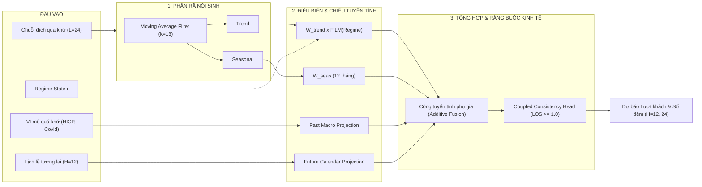

# ⚡ ĐẶC TẢ KIẾN TRÚC MÔ HÌNH RA-Exo-DLinear (FEATURE/LINEAR)

## 1. BỐI CẢNH & ĐỘNG LỰC HỌC THUẬT
Trên nhánh `feature/linear`, đề tài mở rộng hướng nghiên cứu đón đầu làn sóng **Linear-Centric Long-Term Time Series Forecasting (LTSF)** bắt nguồn từ bài báo chấn động của *Zeng et al., AAAI 2023* (*"Are Transformers Effective for Time Series Forecasting?"*).

### Khoảng trống nghiên cứu (Research Gap):
* **Hạn chế của LTSF-Linear gốc (DLinear / NLinear):** Là mô hình đơn biến/độc lập kênh (Channel-Independent), hoàn toàn không thể xử lý biến ngoại sinh đa biến (54 biến lịch lễ, giá HICP, Covid) và không thích ứng được cú sốc gãy khúc thị trường (Regime shifts).
* **Đóng góp của RA-Exo-DLinear:** Đề xuất một biến thể Linear mở rộng chuyên biệt cho dữ liệu du lịch Châu Âu, vừa bảo toàn ưu thế siêu nhẹ (Green AI, train trong vài giây, không overfit) của Linear, vừa khắc phục triệt để 2 hạn chế trên.

---

## 2. KIẾN TRÚC TOÁN HỌC CỦA RA-Exo-DLinear

### Công thức phân rã phụ gia mở rộng:
$$\hat{y} = \hat{y}_{\text{trend}}(r) + \hat{y}_{\text{seasonal}} + \hat{y}_{\text{future\_exo}} + \hat{y}_{\text{past\_exo}} + \text{Bias}_{\text{entity}}$$

1. **Regime FiLM Modulation trên Trend:**
   $$\hat{y}_{\text{trend}}(r) = \big(W_{\text{trend}} \cdot y_{\text{trend}}\big) \odot \big(1 + \tanh(\text{Linear}(e_r))\big) + \text{Linear}(e_r)$$
2. **Dual-Stream Exogenous Projection:**
   * Tương lai biết trước ($X_{\text{future}}$): Chiếu đặc trưng bước-theo-bước vào không gian dự báo.
   * Quá khứ quan sát ($X_{\text{past}}$): Chiếu thời gian $L \rightarrow H$ để truyền dẫn dư chấn lạm phát/dịch bệnh.
3. **Coupled Consistency Head:**
   * $\hat{y}_{\text{arrivals}} = \text{Softplus}(\hat{y}_{\text{raw}, 1})$
   * $\hat{y}_{\text{nights}} = \hat{y}_{\text{arrivals}} \times \big(1.0 + \text{Softplus}(\text{ratio\_head})\big)$
   👉 Đảm bảo triệt tiêu $100\%$ lỗi vi phạm số đêm < số khách.

---

## 3. KẾ HOẠCH ĐỐI SÁNH THỰC NGHIỆM (10 MÔ HÌNH)

Toàn bộ mã nguồn trên nhánh `main` được **bảo toàn nguyên vẹn** để phục vụ đối sánh trực tiếp trong [`benchmark_models.py`](file:///home/tuantn1807/project/nckh_2027/benchmark_models.py):

| Nhóm phương pháp | Mô hình đại diện | Nguồn gốc / Vị thế y văn |
| :--- | :--- | :--- |
| **Statistical** | Seasonal Naive (S-Naive) | Baseline kinh tế lượng cổ điển |
| **Machine Learning** | Standard XGBoost | Chen & Guestrin, 2016 |
| **Machine Learning** | Standard LightGBM | Ke et al., 2017 |
| **Modern Linear LTSF** | Vanilla DLinear | Zeng et al., AAAI 2023 |
| **Modern Linear LTSF** | Vanilla NLinear | Zeng et al., AAAI 2023 |
| **Modern Linear LTSF** | **RA-Exo-DLinear ⭐** | **Mô hình Linear đề xuất mới** |
| **Classical Deep Learning**| Standard LSTM | Hochreiter & Schmidhuber, 1997 |
| **Classical Deep Learning**| Vanilla BiLSTM | Graves et al., 2013 |
| **Tabular Ablation** | CatBoost-Regime | Trụ cột vĩ mô bóc tách |
| **Proposed Hybrid** | **RA-HE-BiLSTM ⭐** | **Khung mô hình lai đa tầng từ nhánh main** |
