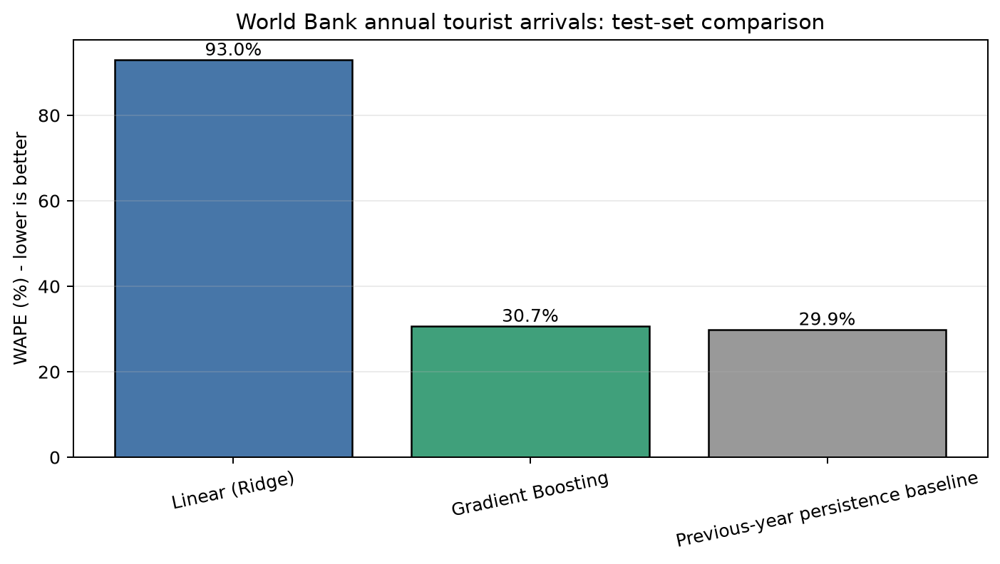

# World Bank full-country model comparison

All models are evaluated on the same annual 2018–2020 test rows. WAPE is calculated on raw tourist-arrival counts; lower is better.

| Model | Test records | MAE | RMSE | WAPE | MAPE |
| --- | ---: | ---: | ---: | ---: | ---: |
| Linear (Ridge) | 497 | 9,491,853 | 36,696,304 | 93.0% | 139.0% |
| Gradient Boosting | 497 | 3,132,834 | 10,933,722 | 30.7% | 103.4% |
| Previous-year persistence baseline | 496 | 3,059,235 | 11,975,313 | 29.9% | 97.3% |

