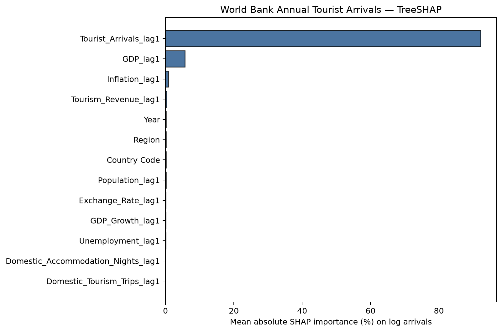

# World Bank Annual Tourism Forecast — XAI Report

- Workbook: `D:\App\RegiTour\RegiTour\data\raw\tourism_economics_worldbank-3.xlsx`
- Target: `Tourist_Arrivals` (annual international tourist arrivals)
- Country/area codes in workbook scope: 203
- Validation period: 2016–2017
- Validation rows explained: 384
- The model predicts `log1p(Tourist_Arrivals)`; SHAP values are in that model-output space.
- Feature attributions describe this fitted model and are not causal effects.

## Permutation importance

| Feature | Importance_Mean | Importance_Std |
| --- | --- | --- |
| Tourist_Arrivals_lag1 | 7.5450 | 0.4483 |
| GDP_lag1 | 0.1305 | 0.0374 |
| Inflation_lag1 | 0.0009 | 0.0008 |
| Tourism_Revenue_lag1 | 0.0008 | 0.0003 |
| Country Code | 0.0007 | 0.0001 |
| Exchange_Rate_lag1 | 0.0002 | 0.0003 |
| Region | 0.0001 | 0.0000 |
| GDP_Growth_lag1 | 0.0000 | 0.0000 |
| Unemployment_lag1 | 0.0000 | 0.0000 |
| Year | 0.0000 | 0.0000 |
| Domestic_Tourism_Trips_lag1 | 0.0000 | 0.0000 |
| Domestic_Accommodation_Nights_lag1 | 0.0000 | 0.0000 |
| Population_lag1 | -0.0005 | 0.0001 |

## TreeSHAP by source variable

| Feature | Mean_Abs_SHAP | Importance_Pct |
| --- | --- | --- |
| Tourist_Arrivals_lag1 | 1.5959 | 92.2092 |
| GDP_lag1 | 0.0978 | 5.6530 |
| Inflation_lag1 | 0.0143 | 0.8260 |
| Tourism_Revenue_lag1 | 0.0064 | 0.3685 |
| Year | 0.0033 | 0.1919 |
| Region | 0.0029 | 0.1704 |
| Country Code | 0.0026 | 0.1527 |
| Population_lag1 | 0.0023 | 0.1326 |
| Exchange_Rate_lag1 | 0.0022 | 0.1257 |
| GDP_Growth_lag1 | 0.0020 | 0.1159 |
| Unemployment_lag1 | 0.0009 | 0.0541 |
| Domestic_Accommodation_Nights_lag1 | 0.0000 | 0.0000 |
| Domestic_Tourism_Trips_lag1 | 0.0000 | 0.0000 |

## One-variable scenario sensitivity

The scenarios perturb one available lagged predictor at a time. They are model sensitivity checks, not causal policy effects.

| Country Code | Country | Year | Feature | Scenario | Baseline_Predicted_Arrivals | Scenario_Predicted_Arrivals | Change_Pct |
| --- | --- | --- | --- | --- | --- | --- | --- |
| ABW | Aruba | 2016 | Tourism_Revenue_lag1 | -10% | 1806843.9498 | 1806843.9498 | 0.0000 |
| AGO | Angola | 2016 | Tourism_Revenue_lag1 | -10% | 683434.4097 | 683434.4097 | 0.0000 |
| ALB | Albania | 2016 | Tourism_Revenue_lag1 | -10% | 4276265.3571 | 4276265.3571 | 0.0000 |
| ARE | United Arab Emirates | 2016 | Tourism_Revenue_lag1 | -10% | 21653174.5414 | 21653174.5414 | 0.0000 |
| ARG | Argentina | 2016 | Tourism_Revenue_lag1 | -10% | 7290470.0032 | 7290470.0032 | 0.0000 |
| ARM | Armenia | 2016 | Tourism_Revenue_lag1 | -10% | 1312119.3061 | 1312119.3061 | 0.0000 |
| ATG | Antigua and Barbuda | 2016 | Tourism_Revenue_lag1 | -10% | 845896.9639 | 845896.9639 | 0.0000 |
| AUS | Australia | 2016 | Tourism_Revenue_lag1 | -10% | 7800307.2838 | 7800307.2838 | 0.0000 |
| AUT | Austria | 2016 | Tourism_Revenue_lag1 | -10% | 26232503.1103 | 26232503.1103 | 0.0000 |
| AZE | Azerbaijan | 2016 | Tourism_Revenue_lag1 | -10% | 2191511.1320 | 2191511.1320 | 0.0000 |
| BEL | Belgium | 2016 | Tourism_Revenue_lag1 | -10% | 8577611.7003 | 8577611.7003 | 0.0000 |
| BEN | Benin | 2016 | Tourism_Revenue_lag1 | -10% | 294838.9128 | 294838.9128 | 0.0000 |

The World Bank workbook contains annual arrivals but no accommodation-night series, HICP accommodation prices, or attention weights.
The former Eurostat-only night/price tables and synthetic attention heatmap are not regenerated.
Existing files such as `xai_price_elasticity.csv` or `attention_cross_temporal_heatmap.png` may remain from an earlier Eurostat run and are not current World Bank outputs.

