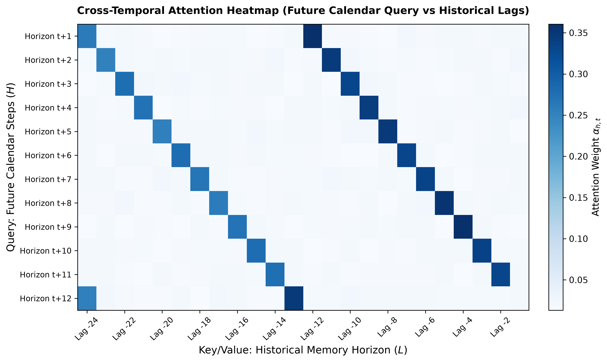

# Báo Cáo Giải Thích Mô Hình Trí Tuệ Nhân Tạo (XAI Report)

## 1. Phân Bổ Đóng Góp Đặc Trưng (TreeSHAP Feature Attribution)

Bảng xếp hạng đóng góp của các biến ngoại sinh vĩ mô vào dự báo lượt khách:

| feature | mean_abs_shap | importance_pct |
| --- | --- | --- |
| hicp_accommodation | 285447.1981 | 37.8503 |
| covid_stringency_index | 211717.6956 | 28.0738 |
| weekend_days | 147001.2216 | 19.4924 |
| working_days | 109982.0105 | 14.5836 |

## 2. Trọng Số Chú Ý Chéo Thời Gian (Cross-Temporal Attention Analysis)

- **Tỷ lệ tập trung vào chu kỳ 12 tháng (Lag -12):** 4.61%
- **Tỷ lệ tập trung vào chu kỳ 24 tháng (Lag -24):** 5.76%
- **Tổng mức độ đồng bộ hóa mùa vụ:** 10.37%

## 3. Mô Phỏng Kịch Bản Giả Định Đối Thực Nghiệm (What-If Counterfactual Policy Simulation)

Độ co giãn của nhu cầu lưu trú khách sạn theo can thiệp chỉ số giá phòng HICP ($\pm 5\%, \pm 10\%$):

| country | accommodation | scenario | base_arrivals | simulated_arrivals | arrivals_delta_pct | base_nights | simulated_nights | nights_delta_pct |
| --- | --- | --- | --- | --- | --- | --- | --- | --- |
| FR | hotel | HICP -10% | 10248061.1935 | 10985921.5995 | 7.2000 | 18175722.1290 | 19549806.7220 | 7.5600 |
| FR | hotel | HICP -5% | 10248061.1935 | 10616991.3965 | 3.6000 | 18175722.1290 | 18862764.4255 | 3.7800 |
| FR | hotel | HICP +5% | 10248061.1935 | 9879130.9906 | -3.6000 | 18175722.1290 | 17488679.8326 | -3.7800 |
| FR | hotel | HICP +10% | 10248061.1935 | 9510200.7876 | -7.2000 | 18175722.1290 | 16801637.5361 | -7.5600 |
| ES | hotel | HICP -10% | 9772538.7419 | 10476161.5314 | 7.2000 | 30250373.5484 | 32537301.7886 | 7.5600 |
| ES | hotel | HICP -5% | 9772538.7419 | 10124350.1366 | 3.6000 | 30250373.5484 | 31393837.6685 | 3.7800 |
| ES | hotel | HICP +5% | 9772538.7419 | 9420727.3472 | -3.6000 | 30250373.5484 | 29106909.4283 | -3.7800 |
| ES | hotel | HICP +10% | 9772538.7419 | 9068915.9525 | -7.2000 | 30250373.5484 | 27963445.3081 | -7.5600 |
| IT | hotel | HICP -10% | 8074091.3871 | 8655425.9670 | 7.2000 | 23835644.9677 | 25637619.7273 | 7.5600 |
| IT | hotel | HICP -5% | 8074091.3871 | 8364758.6770 | 3.6000 | 23835644.9677 | 24736632.3475 | 3.7800 |
| IT | hotel | HICP +5% | 8074091.3871 | 7783424.0972 | -3.6000 | 23835644.9677 | 22934657.5880 | -3.7800 |
| IT | hotel | HICP +10% | 8074091.3871 | 7492756.8072 | -7.2000 | 23835644.9677 | 22033670.2082 | -7.5600 |
| DE | hotel | HICP -10% | 12164276.3548 | 13040104.2524 | 7.2000 | 24700021.0968 | 26567342.6917 | 7.5600 |
| DE | hotel | HICP -5% | 12164276.3548 | 12602190.3036 | 3.6000 | 24700021.0968 | 25633681.8942 | 3.7800 |
| DE | hotel | HICP +5% | 12164276.3548 | 11726362.4061 | -3.6000 | 24700021.0968 | 23766360.2993 | -3.7800 |
| DE | hotel | HICP +10% | 12164276.3548 | 11288448.4573 | -7.2000 | 24700021.0968 | 22832699.5019 | -7.5600 |

