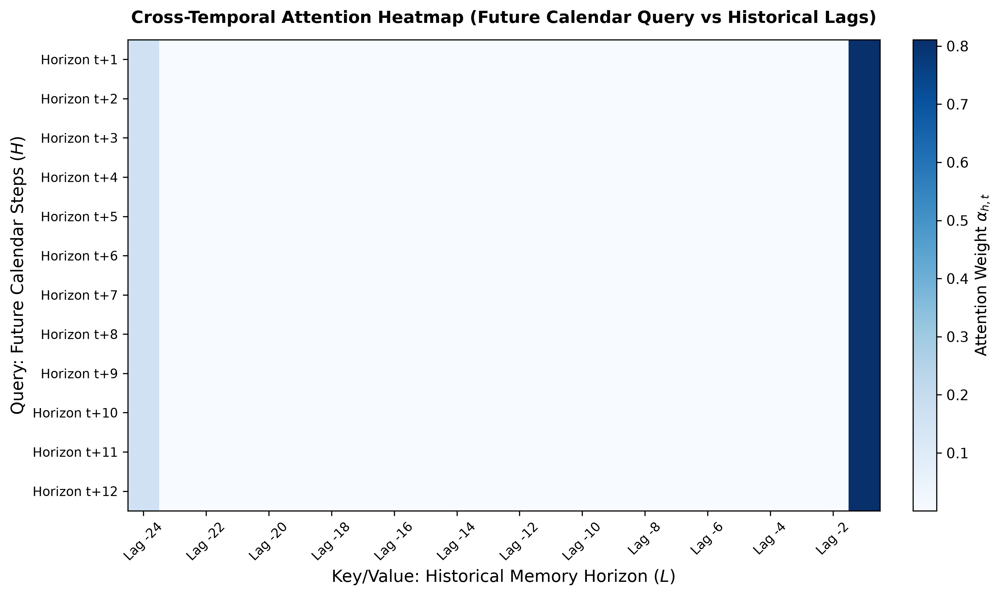

# Báo Cáo Giải Thích Mô Hình Trí Tuệ Nhân Tạo (XAI Report)

## 1. Phân Bổ Đóng Góp Đặc Trưng (TreeSHAP Feature Attribution)

Bảng xếp hạng đóng góp của các biến ngoại sinh vĩ mô vào dự báo lượt khách:

| feature | mean_abs_shap | importance_pct |
| --- | --- | --- |
| hicp_accommodation | 284666.9628 | 37.8784 |
| covid_stringency_index | 210918.9722 | 28.0653 |
| weekend_days | 147813.8691 | 19.6684 |
| working_days | 108128.8961 | 14.3879 |

## 2. Trọng Số Chú Ý Chéo Thời Gian (Cross-Temporal Attention Analysis)

- **Tỷ lệ tập trung vào chu kỳ 12 tháng (Lag -12):** 0.05%
- **Tỷ lệ tập trung vào chu kỳ 24 tháng (Lag -24):** 16.36%
- **Tổng mức độ đồng bộ hóa mùa vụ:** 16.41%

## 3. Mô Phỏng Kịch Bản Giả Định Đối Thực Nghiệm (What-If Counterfactual Policy Simulation)

Độ co giãn của nhu cầu lưu trú khách sạn theo can thiệp chỉ số giá phòng HICP ($\pm 5\%, \pm 10\%$):

| country | accommodation | scenario | base_arrivals | simulated_arrivals | arrivals_delta_pct | base_nights | simulated_nights | nights_delta_pct |
| --- | --- | --- | --- | --- | --- | --- | --- | --- |
| FR | hotel | HICP -10% | 10352806.7500 | 11098208.8360 | 7.2000 | 18378715.5625 | 19768146.4590 | 7.5600 |
| FR | hotel | HICP -5% | 10352806.7500 | 10725507.7930 | 3.6000 | 18378715.5625 | 19073431.0108 | 3.7800 |
| FR | hotel | HICP +5% | 10352806.7500 | 9980105.7070 | -3.6000 | 18378715.5625 | 17684000.1142 | -3.7800 |
| FR | hotel | HICP +10% | 10352806.7500 | 9607404.6640 | -7.2000 | 18378715.5625 | 16989284.6660 | -7.5600 |
| ES | hotel | HICP -10% | 9911745.5625 | 10625391.2430 | 7.2000 | 30830000.2188 | 33160748.2353 | 7.5600 |
| ES | hotel | HICP -5% | 9911745.5625 | 10268568.4028 | 3.6000 | 30830000.2188 | 31995374.2270 | 3.7800 |
| ES | hotel | HICP +5% | 9911745.5625 | 9554922.7222 | -3.6000 | 30830000.2188 | 29664626.2105 | -3.7800 |
| ES | hotel | HICP +10% | 9911745.5625 | 9198099.8820 | -7.2000 | 30830000.2188 | 28499252.2022 | -7.5600 |
| IT | hotel | HICP -10% | 8194005.7188 | 8783974.1305 | 7.2000 | 24482100.3750 | 26332947.1634 | 7.5600 |
| IT | hotel | HICP -5% | 8194005.7188 | 8488989.9246 | 3.6000 | 24482100.3750 | 25407523.7692 | 3.7800 |
| IT | hotel | HICP +5% | 8194005.7188 | 7899021.5129 | -3.6000 | 24482100.3750 | 23556676.9808 | -3.7800 |
| IT | hotel | HICP +10% | 8194005.7188 | 7604037.3070 | -7.2000 | 24482100.3750 | 22631253.5866 | -7.5600 |
| DE | hotel | HICP -10% | 12234743.0938 | 13115644.5965 | 7.2000 | 24876972.6562 | 26757671.7891 | 7.5600 |
| DE | hotel | HICP -5% | 12234743.0938 | 12675193.8451 | 3.6000 | 24876972.6562 | 25817322.2227 | 3.7800 |
| DE | hotel | HICP +5% | 12234743.0938 | 11794292.3424 | -3.6000 | 24876972.6562 | 23936623.0898 | -3.7800 |
| DE | hotel | HICP +10% | 12234743.0938 | 11353841.5910 | -7.2000 | 24876972.6562 | 22996273.5234 | -7.5600 |

